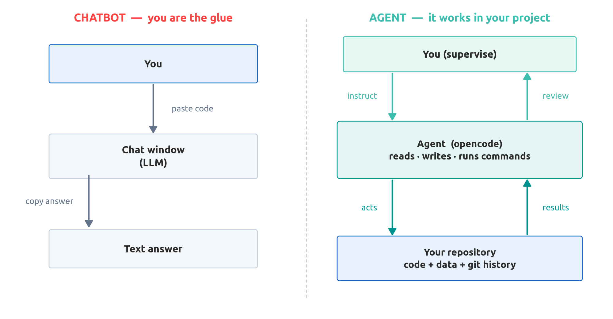
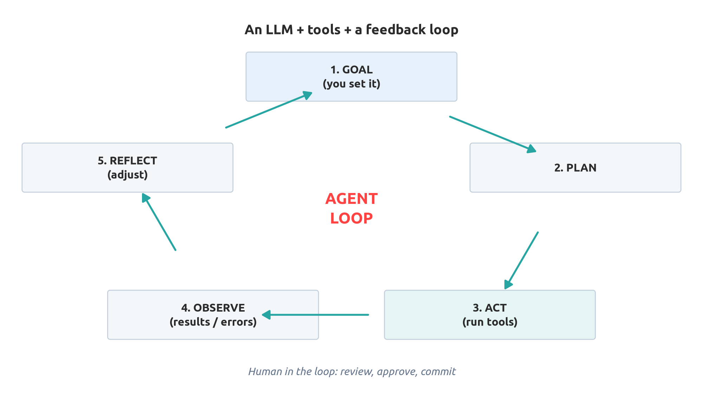
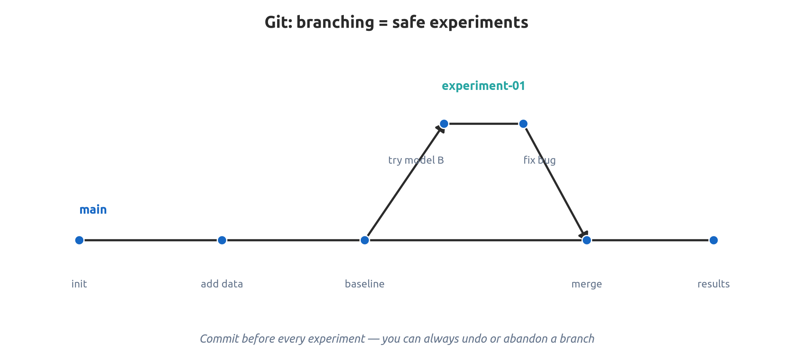
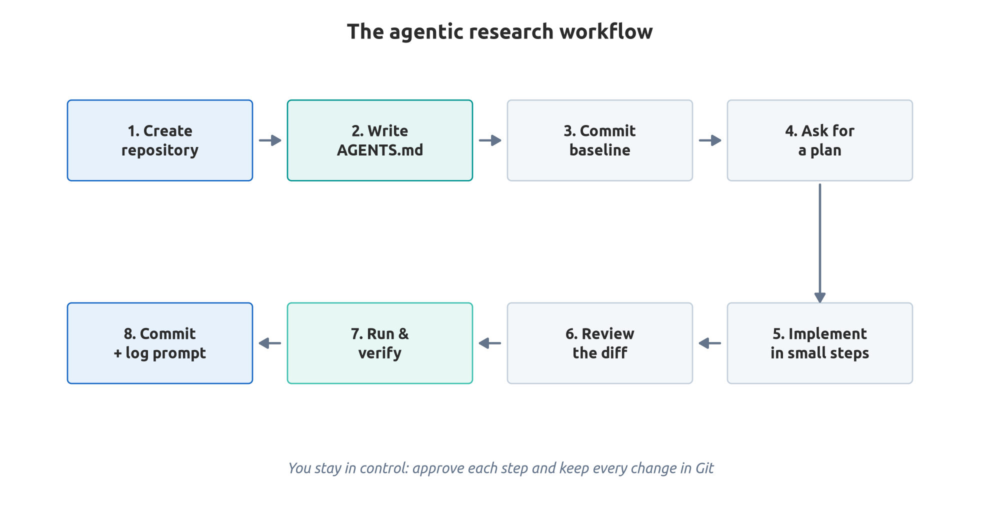

```{r}
#| echo: false
# Recria os arquivos do template local (tema, logo, bib) a partir do pacote classtools
classtools::setup_quarto_slides()
```

# Introdução

## Pesquisa é um Processo Iterativo

> Pesquisa é uma investigação sistemática para descrever, explicar, prever e controlar o fenômeno observado. [@babbie2015practice]

::: {.incremental}
- Um projeto de pesquisa envolve milhares de pequenas decisões: código, dados, escrita, referências bibliográficas.
- A maior parte do tempo **não** é gasta pensando, mas sim em **trabalho mecânico**:
  - limpeza de dados, depuração de scripts, formatação de tabelas, resolução de erros.
- A **IA Agêntica** atua exatamente nessa camada mecânica, permitindo que você dedique mais tempo à reflexão e à análise crítica.
:::

## Por Que IA "Agêntica"?

::: {.columns}
::: {.column width="50%"}
### A forma tradicional
::: {.incremental}

- Janela de chat aberta ao lado do seu projeto.
- Você cola o código e copia as respostas de volta.
- Sem memória ou contexto sobre os arquivos do projeto.
- Você atua como a "cola" manual entre a IA e o seu trabalho.
:::
:::

::: {.column width="50%"}
### A abordagem agêntica
::: {.incremental}

- A IA opera **dentro** da pasta do seu projeto.
- Ela lê arquivos, executa código, corrige erros e itera.
- Segue instruções armazenadas no próprio repositório.
- Você supervisiona, avalia e aprova.
:::
:::
:::


# Dos LLMs aos Agentes

## O Que É um Grande Modelo de Linguagem (LLM)?

> Um LLM é um *motor de raciocínio e linguagem* — não uma base de dados e muito menos uma fonte absoluta da verdade.

::: {.incremental}
- Uma rede neural treinada para **prever o próximo token** a partir de volumes massivos de texto. [@vaswani2017attention]
- Seu conhecimento fica **congelado** na data de corte do treinamento.
- Por si só, **não possui acesso** aos seus arquivos locais, aos seus dados ou à internet em tempo real.
- **É extremamente competente com linguagem e padrões, e muito convincente ao soar confiante mesmo quando está errado. [@bender2021dangers]**
:::


## Chatbot vs. Agente

| Dimensão | Chatbot (interface de chat) | Agente (ex.: opencode) |
|:---|:---|:---|
| **Interface** | Caixa de chat | Terminal / editor dentro do projeto |
| **Contexto** | Apenas o que você cola | Seus arquivos, pastas e histórico Git |
| **Ações** | Gera texto | Lê/escreve arquivos, roda comandos, navega |
| **Memória** | Uma conversa isolada | Sessão + `AGENTS.md` + estado do repo |
| **Ciclo (loop)** | Turno único (pergunta/resposta) | Planeja, age, observa e itera |
| **Seu papel** | Copiar e colar | Supervisionar e aprovar |

## Chatbot vs. Agente: O Fluxo

{width=92%}


## O Ciclo do Agente, Visualizado

{width=78%}

## Níveis de Autonomia

> Comece no nível que você consegue supervisionar. A autonomia deve ser *conquistada* com base na confiabilidade.

::: {.incremental}
- **Sugestão (Suggestion)** — sugestões no estilo autocompletar.
- **Chat** — respostas conversacionais às suas perguntas.
- **Uso de ferramentas (Tool use)** — o modelo invoca ferramentas (arquivos, código, buscas). [@schick2023toolformer]
- **Autonomia supervisionada** — tarefas em múltiplas etapas com sua aprovação a cada passo.
- **Autonomia total** — execução de ponta a ponta. Poderosa, mas arriscada: use em ambiente isolado (sandbox). [@lu2024aiscientist]
:::


## O Que Agentes Realmente Podem Fazer com comprovada eficácia

::: {.columns}
::: {.column width="50%"}
- Ler e resumir um repositório
- Escrever, refatorar e depurar código
- Executar scripts e interpretar erros
- Limpar e reestruturar bases de dados
- Pesquisar em arquivos e na internet
- Gerar relatórios e apresentações de slides (**CUIDADO: o texto fica robótico e repetitivo**)
:::

::: {.column width="50%"}
- Redigir rascunhos e traduzir textos
- Construir gráficos e tabelas
- Consultar bancos de dados via ferramentas (MCP)
- Explicar códigos desconhecidos
- Converter formatos (PDF, CSV, LaTeX)
- ... e encadear todas as tarefas acima
:::
:::

## Sistemas Multiagente (a fronteira)

::: {.incremental}
- Múltiplos agentes especializados colaboram entre si: um **planejador**, um **programador**, um **revisor**. [@wu2024autogen]
- Úteis para tarefas complexas, mas mais difíceis de supervisionar e reproduzir.
- Para pesquisa científica, um **único agente bem instruído** costuma ser o melhor ponto de partida.
- A pesquisa sobre descoberta científica autônoma avança rápido — e levanta questões profundas sobre responsabilidade. [@lu2024aiscientist]
:::

# Ferramentas Essenciais

## A Caixa de Ferramentas de Pesquisa

| Camada | Ferramentas |
|:---|:---|
| **Controle de versão** | **Git**, GitHub / GitLab |
| **Agente de código** | **opencode**, Claude Code, Codex, Copilot, Gemini CLI |
| **Linguagens** | R, **Python**, Julia, SQL |
| **Ambientes** | renv (R), uv / venv (Python), Docker |
| **Escrita e relatórios** | Quarto, LaTeX, Zotero / BibTeX |
| **Dados** | Parquet, DuckDB, DVC, Git LFS |
| **Contexto do agente** | **`AGENTS.md`**, servidores MCP, skills |

## Git — A Espinha Dorsal da Pesquisa Reprodutível

> Se não está sob controle de versão, nunca aconteceu.

::: {.incremental}
- **Controle de versão** para código, texto e pequenos conjuntos de dados.
- Registra **quem alterou o quê, quando e por quê**.
- Permite **desfazer** praticamente qualquer alteração e criar **ramos (branches)** para testar ideias arriscadas.
- Viabiliza a colaboração sem precisar enviar por e-mail `analise_final_v3_REAL.zip`.
- Hospedagem remota (GitHub/GitLab) oferece backup, visibilidade e portfólio acadêmico.
:::


## Git — Comandos Essenciais

```bash
# Iniciar um repositório
git init
git add .
git commit -m "Estrutura inicial do projeto"

# Inspecionar
git status
git log --oneline --graph
git diff                 # o que mudou desde o último commit

# Testar um experimento com segurança
git branch experimento-01
git checkout experimento-01
# ... trabalhar, depois mesclar (merge) ou descartar ...

# Fazer backup e colaborar
git remote add origin <url-do-repositorio>
git push -u origin main
git pull
```

## Git — Ramificação = Experimentos Seguros

::: {.columns}
::: {.column width="50%"}
### Por que criar branches importa
- Testar um novo método sem quebrar o artigo em andamento.
- Descartar uma ideia que falhou com um único comando.
- Comparar duas abordagens de modelagem lado a lado.
- Manter o branch principal (`main`) limpo e citável.
:::

::: {.column width="50%"}
### Hábitos saudáveis de pesquisa
- Um commit = uma mudança lógica.
- Escrever mensagens de commit informativas.
- Fazer commit **antes** de solicitar alterações ao agente.
- Criar tags com a versão exata utilizada no artigo publicado.
:::
:::

## Ramificação no Git, Visualizada

{width=92%}

## Git — Proteja Seus Segredos e Dados

```bash
# .gitignore  -> arquivos que o Git NUNCA deve rastrear
.env
*_token.json
credentials/
data/raw/          # dados brutos volumosos ou confidenciais
_cache/
*.html             # saídas geradas automaticamente
```

::: {.incremental}
- **Nunca** comite chaves de API, senhas ou dados pessoais/confidenciais.
- Se um segredo for enviado ao repositório remoto, considere-o comprometido: revogue e troque-o imediatamente.
- Mantenha os dados brutos imutáveis e fora do versionamento se forem volumosos ou sensíveis.
:::

## opencode — Seu Agente Dentro do Projeto

::: {.incremental}
- Um **agente de código aberto (open-source)** que roda no terminal (TUI) e no desktop.
- **Agnóstico quanto ao modelo**: conecta-se a OpenAI, Anthropic, Google ou modelos locais (ex.: Ollama).
- Opera **direto no repositório**: lê código, edita arquivos, executa comandos.
- Mantém **sessões** que podem ser retomadas, com **permissões** explícitas para você aprovar ou rejeitar cada ação.
- Configurável via `opencode.json`, **`AGENTS.md`**, comandos personalizados, skills e plugins.
:::

> Em vez de copiar respostas de uma janela de chat, você *colabora diretamente sobre os arquivos reais*.

## opencode — Principais Capacidades

::: {.columns}
::: {.column width="50%"}
- Compreende toda a estrutura do projeto
- Edita múltiplos arquivos de forma consistente
- Executa comandos no shell e roda testes
- Interpreta erros e se autocorige
- Usa o **Git** para exibir diffs e criar commits
:::

::: {.column width="50%"}
- Conecta-se a ferramentas externas via **MCP**
- Suporta **comandos personalizados** e repetíveis
- Mantém histórico de sessão que pode ser retomado
- Permite trocar de modelo conforme a tarefa
- Código aberto e customizável via scripts
:::
:::

## Por Que o Agente Deve Ficar no Repositório?

::: {.incremental}
- O **contexto é o próprio projeto**, e não um histórico solto de chat.
- Cada modificação fica **visível no diff do Git**, podendo ser revisada ou revertida.
- As diretrizes residem em um **arquivo versionado**, e não guardadas na sua memória.
- O fluxo de trabalho se torna **reprodutível e auditável** — pilar indispensável para a ciência.
- Mesmo repositório + mesmas instruções ⇒ comportamento da IA muito mais consistente.
:::

## Outras Ferramentas Relevantes

::: {.columns}
::: {.column width="50%"}
**Agentes e assistentes**
- Claude Code, GitHub Copilot, Codex
- Gemini CLI, Cursor, Aider

**Reprodutibilidade**
- Docker, `renv`, `uv`, Conda
- DVC, Git LFS, DuckDB
:::

::: {.column width="50%"}
**Escrita científica**
- Quarto, LaTeX
- Zotero + BibTeX

**Integração**
- **MCP** — conecta agentes a bancos de dados, arquivos e gerenciadores de referências
- Modelos locais (Ollama) para dados sensíveis
:::
:::

# AGENTS.md

## `AGENTS.md` — O README para Agentes

> `AGENTS.md` é um arquivo Markdown simples e aberto que explica ao agente de código **como o seu projeto funciona** e **como ele deve se comportar**.

::: {.incremental}
- Fica na **raiz do repositório** (assim como o `README.md`).
- É lido automaticamente pelo opencode e pela maioria das ferramentas modernas de agentes.
- Atua como um **contrato** entre você e o agente. [agents.md](https://agents.md)
- Pense nele como o **manual de integração para um novo colaborador** — com a diferença de que esse colaborador é uma IA.
:::

## Por Que o `AGENTS.md` É Importante

> Um bom `AGENTS.md` é a forma mais barata e eficaz de aumentar drasticamente a confiabilidade do agente.

::: {.incremental}
- **Contexto persistente**: você não precisa reexplicar o projeto a cada nova sessão.
- **Consistência**: o agente segue as mesmas diretrizes em todas as execuções.
- **Limites de segurança (guardrails)**: você define o que nunca deve ser alterado ou executado.
- **Reprodutibilidade**: as instruções da IA passam a fazer parte da rastreabilidade da pesquisa.
- **Menos alucinações**: o agente executa os comandos *reais* do projeto, em vez de inventá-los.
- **Ativo para a equipe**: documenta a dinâmica do projeto também para colaboradores humanos.
:::


## O Que Incluir no `AGENTS.md`

| Seção | Pergunta que responde |
|:---|:---|
| **Visão geral do projeto** | Sobre o que é este projeto? |
| **Estrutura** | Onde ficam os dados / códigos / resultados? |
| **Comandos** | Como compilar, executar e testar o código? |
| **Convenções** | Linguagem, estilo, nomenclatura, pacotes |
| **Limites (boundaries)** | O que nunca deve ser modificado ou compartilhado? |
| **Critério de conclusão (definition of done)** | Como sabemos que uma tarefa está pronta? |

## Exemplo de `AGENTS.md` (Projeto de Pesquisa)

````markdown
# AGENTS.md

## Projeto
Estudo empírico sobre X. Dados brutos em `data/raw` (somente leitura),
código em `R/`, resultados em `output/`.

## Comandos
- Restaurar ambiente: `Rscript -e 'renv::restore()'`
- Rodar análise completa: `Rscript R/01_run_all.R`
- Gerar o relatório:   `quarto render report.qmd`

## Convenções
- Linguagem: R (tidyverse). Indentação de 2 espaços, nomes em snake_case.
- Nunca modificar arquivos em `data/raw/`.
- Todas as figuras devem ser salvas em `output/figs/`.
- Todo script deve rodar de ponta a ponta sem etapas manuais.

## Regras
- NÃO comite segredos (`.env`, `*_token.json`).
- NÃO invente dados, resultados ou citações bibliográficas.
- Peça autorização antes de excluir qualquer arquivo.
- Após qualquer alteração, execute `Rscript R/01_run_all.R` e relate eventuais erros.
````

## O Fluxo de Trabalho de Pesquisa Agêntica

::: {.incremental}
1. **Crie o repositório** — `git init` seguido do primeiro commit.
2. **Escreva o `AGENTS.md`** *antes* de solicitar qualquer tarefa.
3. **Faça o commit de uma base limpa** para poder reverter sempre que necessário.
4. **Peça um plano primeiro** — "planeje apenas, não altere arquivos ainda".
5. **Implemente em pequenos passos**, aprovando cada modificação.
6. **Revise o diff**; execute o código e os testes por conta própria.
7. **Faça commit** de cada estado funcional com mensagens claras.
8. **Repita o ciclo** — mantendo um registro de prompts, modelos e datas.
:::

## O Fluxo de Trabalho de Ponta a Ponta

{width=92%}


## Exemplos de Tarefas para o Agente

::: {.incremental}
- "Resuma este repositório: objetivo principal, pontos de entrada e como executá-lo."
- "Refatore este script longo em funções modulares e adicione testes."
- "Escreva um relatório em Quarto reproduzindo a Tabela 2 a partir de `data/processed/panel.parquet`."
- "Explique este erro e proponha uma correção — não altere nenhum arquivo por enquanto."
- "Converta estes 200 PDFs extraídos via web scraping em um dataframe estruturado."
- "Elabore um rascunho de revisão bibliográfica com base nestes 30 PDFs e gere uma matriz de citações."
:::

## Engenharia de Prompts para Pesquisa

::: {.incremental}
- Forneça ao agente **papel, contexto, objetivo, restrições, formato esperado e exemplos**.
- Peça **um plano antes de agir**; avalie a estratégia antes de autorizar alterações nos arquivos.
- Disponibilize o **esquema dos dados (schema)** e uma amostra pequena, e não um arquivo bruto de 2 GB.
- Defina explicitamente **idioma, estilo de escrita e formato de citação**.
- Avance em **pequenas etapas incrementais** e valide cada uma delas.
- Peça ao agente que **indique os arquivos e números de linha** em que baseou suas respostas.
:::

## Padrões de Prompts (Prompt Patterns)

| Objetivo | Padrão de prompt |
|:---|:---|
| **Explorar** | "Resuma este repositório: objetivo, pontos de entrada e como executá-lo." |
| **Planejar** | "Proponha um plano passo a passo. Não modifique arquivos ainda." |
| **Implementar** | "Implemente apenas o passo 2. Exiba o diff das alterações." |
| **Depurar** | "Aqui estão o erro e o arquivo. Identifique a causa e proponha a solução." |
| **Revisar** | "Revise este script quanto a bugs e problemas de reprodutibilidade." |
| **Escrever** | "Redija a seção de Metodologia citando exclusivamente as referências fornecidas." |


# O lado negro das LLMs

## O Problema das Alucinações

> Confie, mas verifique — e verifique novamente.

::: {.incremental}
- LLMs **inventam** citações, DOIs, números de páginas — e, em alguns casos, até bases de dados.
- Uma resposta fluida, convincente e bem formulada **não** constitui evidência científica.
- **Nunca** cite uma referência bibliográfica que você não tenha aberto e lido.
- Verifique cada citação (DOI, Crossref, Google Scholar, o PDF de fato).
- Faça a checagem cruzada de cada valor numérico contra o código que o gerou.
:::

## Autoria, Declaração e Aspectos Legais

::: {.columns}
::: {.column width="50%"}
- **Você** é o responsável final pelo trabalho publicado.
- Ferramentas de IA em geral **não podem figurar como autoras** (não assumem responsabilidade jurídica ou científica).
- **Declare** o emprego de ferramentas de IA na seção de Métodos ou Agradecimentos.
:::

::: {.column width="50%"}
- Respeite as exigências de **periódicos, agências de fomento e da universidade**.
- Respeite as **licenças de software e direitos autorais** de códigos e textos.
- Não cometa plágio, mesmo que "tenha sido o modelo quem redigiu".
:::
:::

## Armadilhas Comuns

::: {.incremental}
- Aceitar código que você não executou nem leu criticamente.
- Permitir que o agente altere dados brutos ou exponha chaves e senhas.
- Citar referências inventadas (alucinações).
- Prompts vagos gerando saídas igualmente vagas e pouco úteis.
- Trabalhar sem controle de versão — perdendo a capacidade de reverter erros.
- Dependência excessiva e desqualificação técnica: você ainda precisa dominar os fundamentos.
- Inserir volumes massivos de contexto e dispersar o foco do agente.
:::


## Ferramentas e Recursos {.unlisted}

- Git — <https://git-scm.com>
- opencode — <https://opencode.ai>
- Padrão `AGENTS.md` — <https://agents.md>
- Quarto — <https://quarto.org/docs/presentations/>
- Model Context Protocol (MCP) — <https://modelcontextprotocol.io>
- Zotero — <https://www.zotero.org>

## Referências {.unlisted}
