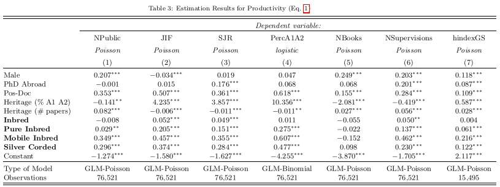
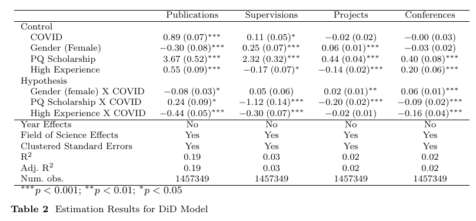

```{r, echo=FALSE}
classtools::setup_quarto_slides("content")
i_exerc <- 0 
```


```{r, echo=FALSE}
exerc.name <- 'ADFER-Exercicio-Aula-10-Models_'
```

```{css, echo=FALSE}
.cell.smaller {
  font-size: 0.8em;
}
```


```{r, echo=FALSE, purl=FALSE}
knitr::opts_chunk$set(prompt = FALSE, 
                      message = FALSE,
                      cache = FALSE, 
                      tidy = FALSE)
```

```{r echo=FALSE, purl=FALSE}
knitr::opts_chunk$set(fig.align = 'center', 
                      tidy = FALSE, 
                      warning = FALSE, 
                      message = FALSE,
                      cache = FALSE)
```

# Introduction

## Why Financial Econometrics?


> The modelling tools from financial econometrics allow the researcher to simulate, predict and test a particular hypothesis about the data. 

. . .

- allow **correctly** testing different hypothesis about the real world

. . .

- models scale well! (likely to be usable for large data)

. . .

- can be very flexible towards a functional form of the data generating process


## Most popular models:

- **Linear models (OLS)**
- **Generalized linear models (GLM)**
- ~~Panel data models (PDM)~~
- **Arima models (Integrated Autoregressive Moving Averages)**
- **Garch models (generalized autoregressive conditional heteroskedasticity)**
- ~~Regime switching models~~


## Please read the references!

- Introductory econometrics for finance [@brooks2014introductory]

- Econometric analysis [@greene2003econometric] 

- The econometrics of financial markets [@campbell1997econometrics]

- Time series analysis [@hamilton1994time]


# Linear Models

## Linear Models

> A linear  model is, without a doubt, one of the most used econometric models in R and finance. 

Why??

. . .

- simplicity

. . .

- quick estimation, even for HUGE amounts of data

. . .

- easy to interpret and process out of sample data

---

A linear model with _N_ explanatory variables can be represented as follows:

$$y _t = \alpha + \beta _1 x_{1,t} + \beta _2 x_{2,t} + ... + \beta _N x_{N,t} + \epsilon _t$$

$y_t$ -- dependent (or response) variable

$x_{i,t}$ -- independent (or explanatory) variables.

$\beta _i$ -- coefficients to be estimated

$\epsilon _t$ -- Residual from linear equation


## Simulating a Linear Model

Consider the following equation:

$$y _t = 0.5 + 2 x_{t} + \epsilon _t$$


```{r}
#| output-location: column
set.seed(50)

# number of obs
nT <- 1000 

# set x as Normal (0, 1)
x <- rnorm(nT)

# set coefficients
my_alpha <- 0.5
my_beta <- 2

# build y
y <- my_alpha + my_beta*x + rnorm(nT)

library(ggplot2)

# set temp df
temp.df <- dplyr::tibble(x, y)

# plot it
p <- ggplot(temp.df, aes(x = x, y = y)) + 
  geom_point(size = 0.5, alpha = 0.4) +
  geom_smooth(method = "lm", se = FALSE, color = "red") +
  geom_abline(intercept = my_alpha, slope = my_beta, 
              color = "blue", linetype = "dashed") +
  labs(x = "x", y = "y",
       title = "Simulated data: true line (blue) vs fitted OLS (red)")

print(p)
```


## Estimating a Linear Model

In R, the main function for estimating a linear model is `lm`. Let's use it to estimate a model from the previous simulated data.

```{r}
#| output-location: column
# set df
df_reg <- dplyr::tibble(x, y)

# estimate linear model
my_lm <- lm(data = df_reg, formula = y ~ x)

print(my_lm)
```

<hr>

```{r}
#| output-location: column
library(broom)

# tidy table of coefficients with confidence intervals
tidy(my_lm, conf.int = TRUE)
```

---

more information about the previously estimated can be found with `summary`: 

```{r}
print(summary(my_lm))
``` 


## Reporting a single Linear Model

The typical model table can be constructed in R with `texreg` or `modelsummary`:

```{r}
#| output: asis
#| output-location: column
library(texreg)

htmlreg(my_lm, 
        include.rownames = FALSE,
        caption = "Simulated linear model")
```

## Reporting many models

```{r}
#| output: asis
#| output-location: column
library(texreg)

# nested models: does the extra flexibility improve the fit?
model_1 <- lm(data = df_reg, formula = y ~ x)
model_2 <- lm(data = df_reg, formula = y ~ x + I(x^2))
model_3 <- lm(data = df_reg, formula = y ~ x + I(x^2) + I(x^3))

htmlreg(l = list(model_1, model_2, model_3), 
        custom.model.names = c("Linear", "Quadratic", "Cubic"),
        include.rownames = FALSE)
```

## A real world example 

> The table is from published paper titled "The Academic Inbreeding Controversy: Analysis and Evidence from Brazil", published in [Journal of Informetrics](https://doi.org/10.1016/j.joi.2022.101287)

```{r}
#| echo: false
#| fig-alt: "Regression table from the paper on academic inbreeding, showing coefficients and significance stars."


```


## Another real world example 

> The table is from a **working paper** titled "The Academia Downturn: the Impact of COVID-19 in the Brazilian Academic Output"

```{r}
#| echo: false
#| fig-alt: "Regression table from the working paper on the impact of COVID-19 on Brazilian academic output, with several model specifications side by side."


```


# Statistical Inference in Linear Models

> After estimating a model with function `lm`, the next step is to test some hypothesis about the coefficients. 

- F-test: verifies the most basic condition for a model to justify its existence -- it tests the assumption that all coefficients, excluding the intercept, are equal to zero.

- T-tests: tests the null hypothesis that individual coefficients (betas) are equal to zero.

- Adjusted R^2: R^2 penalized by the number of parameters, so it does not automatically increase when irrelevant variables are added.

## The F-test in `summary()`

When function `summary` is applied to a `lm` output, the F-test is provided by default in the last line of the text output. The null hypothesis of the test is that all slopes are equal to zero. Let's try it:

```{r, purl=FALSE, echo=TRUE}
nT <- 100
df <- data.frame(y = runif(nT),
                 x1 = runif(nT),
                 x2 = runif(nT))

my_lm <- lm(data = df, 
            formula = y ~ x1 + x2)

print(summary(my_lm))
```


## Alternative hypothesis in linear regressions

> While T-test calculate the p-values associated with the event of the individual coefficient being equal to zero, we can also design other tests using a [Wald Test](https://en.wikipedia.org/wiki/Wald_test), such as a particular parameter being equal to a value

As a simple example, let's test a linear hypothesis for a simulated model. Here, we will create artificial data and test the formal hypothesis that the estimated coefficients are equal to the actual values provided in the simulation. 

```{r}
set.seed(10)

# number of time periods
nT <- 1000

# set parameters
intercept <- 0.5
beta <- 1.5

# simulate
x <- rnorm(nT)
y <- intercept + beta*x + rnorm(nT)

# set df
df <- data.frame(y, x)

# estimate model
my_lm <- lm(data = df, 
            formula = y ~ x )
```

- After the estimation of the model, we use function `LinearHypothesis` from package `car` [@car] to implement our formal test. 

- The tested hypotheses are represented using a matrix operation. With this matrix operation, we test the joint hypothesis that the intercept is equal to `r intercept` and the slope is equivalent to `r beta`.

$$
\underbrace{\begin{bmatrix}
1 & 0 \\
0 & 1
\end{bmatrix}}_{hypothesis.matrix}\begin{bmatrix}
\alpha \\
\beta
\end{bmatrix} = \underbrace{\begin{bmatrix}
0.5 \\ 
1.5  
\end{bmatrix} }_{rhs}
$$

The actual R code that implements the test is given next.

```{r}
library(car)

# set test matrix
test_matrix <- matrix(c(intercept,  # alpha test value
                        beta))  # beta test value

# hypothesis matrix 
hyp_mat <- matrix(c(1,0,
                    0,1),nrow = 2)

# do test
my_waldtest <- linearHypothesis(my_lm, 
                                hypothesis.matrix = hyp_mat, 
                                rhs = test_matrix)

# print result
print(my_waldtest)
```

As we can see, the test fails to reject the null hypothesis. This means our simulation worked, and the parameters are correctly estimated as expected. 


## Testing OLS assumptions

> Another family of tests commonly applied to linear models is related to its assumptions. Every linear model estimated by OLS assumes:

1) linearity in the parameters,
2) independence of the errors,
3) homoscedasticity (constant variance),
4) no perfect multicollinearity,
5) errors approximately Normal (mainly for small-sample inference).

- If these assumptions are not true, the model may be inefficient or biased, meaning some modification or use of robust estimates is required. 

## Visual diagnostics

> Formal tests are useful, but plots often reveal the problem faster.

```{r}
#| fig-width: 9
#| fig-height: 4

par(mfrow = c(1, 2))
plot(my_lm, which = 1:2)
```

- **Residuals vs fitted**: a funnel shape suggests heteroscedasticity.
- **Normal Q-Q**: points far from the straight line suggest non-Normal errors.

## R packages for testing OLS assumptions

- package `lmtest` [@R-lmtest] tests for independence with the Breusch-Godfrey and Durbin-Watson tests. 

- The Shapiro-Wilk test for normality is available in package `stats`.

```{r, results='hold'}
library(lmtest)

# Breusch-Godfrey test - Serial correlation
# Null hypothesis: no serial correlation in residuals
print(bgtest(my_lm, order = 5))

# Breusch-Pagan test - Non-constant variance
# Null hypothesis: homoscedasticity
print(ncvTest(my_lm))

# Durbin-Watson test - Serial correlation
# Null hypothesis: no serial correlation in residuals
print(dwtest(my_lm))

# Shapiro-Wilk test - Normality
# Null hypothesis: data is normally distributed
print(shapiro.test(my_lm$residuals))
```

As expected, the model with artificial data passed all tests.

`dwtest()` assumes the residuals are in time order. Here the data is i.i.d., so treat this result as illustrative; we will use the test properly with time series.

## Robust standard errors

> If heteroscedasticity is present, the OLS point estimates are still unbiased, but the classical standard errors are wrong. A simple fix is to use heteroscedasticity-robust standard errors.

```{r}
set.seed(123)

n <- 500
x <- runif(n, 1, 10)
y <- 1 + 2*x + rnorm(n, sd = x)   # variance grows with x
df_het <- tibble::tibble(x, y)
lm_het <- lm(y ~ x, data = df_het)

library(sandwich)
library(lmtest)

# classical standard errors
print(coeftest(lm_het))

# heteroscedasticity-robust standard errors (HC1)
print(coeftest(lm_het, vcov = vcovHC(lm_het, type = "HC1")))
```

- The coefficients are identical; only the standard errors, t-statistics and p-values change.
- The robust version is usually the safer default when the variance of the errors is not constant.

## Global validation

> Package `gvlma` [@R-gvlma] provides a top level function that can execute all sorts of tests in linear models, including the ones described before. The main advantage is that it outputs all tests in a single function call. 

```{r}
library(gvlma)

# global validation of model
gvmodel <- gvlma(my_lm) 

# print result
summary(gvmodel)
```


# Generalized Linear Models (GLM)

## Introduction

> The generalized linear model (GLM) is a flexible alternative to a linear model. It allows the user to change the distribution of the response and the link function, which specifies how the expected response relates to the linear predictor.

- GLM is the right choice when the response is not continuous and unbounded: binary (`binomial`), counts (`poisson`), or positive continuous (`Gamma`).

- Applications of GLM in finance are mostly in credit models, which are used to predict the likelihood of an individual or company to default on its debt.

## Specification

We can write a general univariate GLM as:

$$E \left( y _t \right) = g \left(\alpha + \sum ^N _{i=1} \beta _i x_{i,t}  \right)$$

Function _g()_ can take many shapes. For example, if we are modelling a binary variable, we can use _g()_ as the _logit_ function:

$$g(x) = \frac{\exp(x)}{1+\exp(x)} $$

- function _g()_ ensures any value of _x_ will result in a number between 0 and 1.


## Why not just use OLS?

> With a binary response, OLS can produce predicted values below 0 or above 1, and the constant-variance assumption is violated.

```{r}
#| layout-ncol: 2
#| fig-width: 6
#| fig-height: 3.5

set.seed(42)
n <- 300
x <- runif(n, -3, 3)
p <- plogis(-1 + 3*x)
y <- rbinom(n, 1, p)
df_bin <- tibble::tibble(x, y)

p_ols <- ggplot(df_bin, aes(x, y)) +
  geom_jitter(height = 0.02, alpha = 0.3) +
  geom_smooth(method = "lm", se = FALSE, color = "red") +
  labs(title = "OLS on a binary response", y = "y (0/1)")

p_glm <- ggplot(df_bin, aes(x, y)) +
  geom_jitter(height = 0.02, alpha = 0.3) +
  geom_smooth(method = "glm", method.args = list(family = binomial),
              se = FALSE, color = "blue") +
  labs(title = "Logistic regression", y = "y (0/1)")

print(p_ols)
print(p_glm)
```

- The OLS line is a straight line and can leave the [0, 1] interval.
- The logistic curve respects the natural bounds of a probability.


## Simulating a GLM Model

As an example, let's simulate the following GLM model, where the response vector is a Bernoulli variable that takes value 1 with probability $p_t$. The probabilities are calculated from the non-linear transformation of $x_t$.

$$p _t  = \frac{\exp(2+5x_t)}{1+\exp(2+5x_t)}$$

In R, we use the following code to build the response vector.

```{r}
set.seed(15)

# set number of obs
n_T <- 500

# set x
x <- rnorm(n_T)

my_alpha <- 2
my_beta <- 5

# set probabilities
z <- my_alpha + my_beta*x
p <- exp(z)/(1+exp(z))

# set response variable
y <- rbinom(n = n_T,
           size = 1, 
           prob = p)
```

## The simulated data

```{r}
#| fig-width: 7
#| fig-height: 4

sim_df <- tibble::tibble(x, p, y)

ggplot(sim_df, aes(x = x, y = p)) +
  geom_line(color = "blue", linewidth = 1) +
  geom_jitter(aes(y = y), height = 0.02, alpha = 0.25) +
  labs(x = "x", y = "Probability / outcome",
       title = "The simulated logistic model")
```

- The blue curve is the true probability $p_t = \exp(2 + 5x_t) / (1 + \exp(2 + 5x_t))$.
- The points are the realized binary outcomes $y_t \in \{0, 1\}$.


## Estimating a GLM Model

- In R, the estimation of GLM models is accomplished with function `r classtools::format_fct_text("stats::glm")`. 

Let's use the previously simulated data to estimate a _logit_ model:

```{r}
# estimate GLM
df <- tibble::tibble(x, y)
my_family <- binomial(link = "logit")
my_glm <- glm(data = df, 
              formula = y ~ x , 
              family = my_family)

# print it with summary
print(summary(my_glm))
```


## An example with data

> Let's use a credit card dataset from [Kaggle](https://www.kaggle.com/uciml/default-of-credit-card-clients-dataset)^[https://www.kaggle.com/uciml/default-of-credit-card-clients-dataset] to model credit risk.

```{r}
# read default data
my_f <- afedR3::data_path('CH11_UCI-Credit-Card.csv')
df_default <- readr::read_csv(my_f)

dplyr::glimpse(df_default)
```

For now, let's simplify the analysis and focus on four columns: sex, education, marriage and age. For that, we'll also need to decode the values in some columns. 

```{r}
library(dplyr)

# read credit card data 
# source: 
# www.kaggle.com/uciml/default-of-credit-card-clients-dataset
# COLUMNS: GENDER: (1 = male; 2 = female). 
#          EDUCATION: 0 = unknown; 1 = graduate school; 
#                     2 = university; 
#                     3 = high school; 
#                     4 = others;
#                     5, 6 = unknown.
#          MARRIAGE: 1 = married; 
#                    2 = single; 
#                    3 = others 
df_default <- df_default |> 
  mutate(default = (default.payment.next.month == 1), 
         D_male_gender = (SEX == 1),
         age = AGE,
         educ = dplyr::recode(as.character(EDUCATION),
                              '0' = 'Unknown',
                              '1' = 'Grad',
                              '2' = 'University', 
                              '3' = 'High School', 
                              '4' = 'Others',
                              '5' = 'Unknown',
                              '6' = 'Unknown'),
         D_marriage = (MARRIAGE == 1)) |>
  select(default, D_male_gender, age, educ, D_marriage) 

glimpse(df_default)

```

> **Data caveat:** 14 observations have `EDUCATION = 0` and none of them defaulted. If left as a separate level, they become the reference category and cause complete separation (huge coefficients and standard errors). We recode `0` to `Unknown`.

Much better! Now we only have the columns of interest, with more appealing names and content. Let's proceed to the estimation of the glm model.

```{r}
#| classes: smaller

# estimate glm model
glm_credit <- glm(data=df_default, 
                  formula = default ~ D_male_gender +  age + 
                                      educ + D_marriage,
                  family = binomial(link = "logit"))

# show output
summary(glm_credit)
```


## Odds ratios

> The coefficients of a logistic model are on the **log-odds** scale. Exponentiating them gives **odds ratios**, which are easier to interpret.

```{r}
#| classes: smaller

library(broom)

tidy(glm_credit, exponentiate = TRUE, conf.int = TRUE) |>
  dplyr::select(term, estimate, conf.low, conf.high, p.value) |>
  dplyr::mutate(dplyr::across(where(is.numeric), \(x) round(x, 3)))
```

- An odds ratio above 1 means higher odds of default; below 1 means lower odds.
- For example, the odds ratio for `D_male_gender` is approximately `r round(exp(coef(glm_credit)["D_male_genderTRUE"]), 2)`.

## Goodness of fit

> The R^2 from OLS does not apply to a binary response. Useful alternatives are the McFadden pseudo-R^2, the AIC and the AUC.

```{r}
# McFadden pseudo-R2
pseudo_r2 <- 1 - as.numeric(logLik(glm_credit) / logLik(update(glm_credit, . ~ 1)))
print(pseudo_r2)

# AIC (lower is better)
print(AIC(glm_credit))
```

- McFadden pseudo-R^2 is usually much smaller than the OLS R^2; values between 0.2 and 0.4 already indicate a very good fit for a binary model.
- Here it is close to zero, consistent with the low AUC: demographics alone explain little about default.
- AIC is useful when comparing models estimated on the same data.

## From probabilities to decisions

> The model outputs a probability, not a yes/no answer. To classify a client, we must choose a threshold.

```{r}
# predicted probability of default
df_default$p_default <- predict(glm_credit, type = "response")

# classify using a 0.5 threshold
df_default$pred_default <- df_default$p_default > 0.5

# confusion matrix
pred_label <- factor(df_default$pred_default,
                     levels = c(TRUE, FALSE),
                     labels = c("Default", "No default"))
actual_label <- factor(df_default$default,
                       levels = c(TRUE, FALSE),
                       labels = c("Default", "No default"))

table(predicted = pred_label,
      actual = actual_label)
```

- At the 0.5 threshold, this model classifies everyone as "no default".
- The default rate is about `r round(mean(df_default$default)*100, 1)`%, so a model that always predicts "no default" would already be right most of the time.
- Accuracy alone is therefore misleading; we need measures such as sensitivity, specificity and AUC.

## ROC and AUC

```{r}
#| fig-width: 5
#| fig-height: 4

library(pROC)

my_roc <- pROC::roc(response = as.numeric(df_default$default),
                    predictor = df_default$p_default,
                    quiet = TRUE)

print(pROC::auc(my_roc))
plot(my_roc, print.auc = TRUE, main = "ROC curve - credit default")
```

- The ROC curve shows the trade-off between sensitivity and specificity for every possible threshold.
- AUC = 0.5 is a useless model; AUC = 1 is perfect. Here, AUC is about `r round(as.numeric(pROC::auc(my_roc)), 3)`.
- This low AUC is expected: demographic variables alone are weak predictors. Real credit models use payment history, balances and other behavioural variables.


```{r, echo=FALSE}
i_exerc <- i_exerc + 1
```
## Exercise `r i_exerc` - Linear Model

1. Using package `yfR`, download adjusted price data for `^BVSP` and `GRND3.SA` from 2015 to 2023. 

2. Estimate the beta of GRND3 from the following model:

$$R_t = \alpha + \beta R_{M,t} + \epsilon _t$$
		
3. Estimate a new market model with a dummy for negative returns:

$$R_t = \alpha + \beta _1 R_{M,t} + \beta _2 D_t R_{M,t}  + \epsilon _t$$

Where $D_t = 1$ if $R_{M,t} <0$ and $D_t = 0$ otherwise

4. With the first model (without dummies), use package `car` to test the hypothesis that $\alpha=0$ and $\beta = 1$

5. Test the underlying assumptions of the previous linear model with package `gvlma`

::: {.notes}
Hints: use `yfR::yf_get()` and compute returns with `dplyr::lag()`. Align the dates and remove missing values before estimating `lm()`. For the Wald test, `car::linearHypothesis()` also accepts restrictions as strings, e.g. `c("(Intercept) = 0", "R_M = 1")`.
:::


```{r, echo=FALSE}
i_exerc <- i_exerc + 1
```
## Exercise `r i_exerc` - Linear Models
1. Using package `yfR`, download adjusted price data for PETR3, PETR4, GGBR3, GGBR4 from 2010 to 2018. 

2. Using loops, estimate and save the beta of all stocks in a dataframe with two columns (ticker, beta):

$$R_t = \alpha + \beta R_{M,t} + \epsilon _t$$

3. Report the results of all models with `texreg::screenreg` in a single table

::: {.notes}
Hints: a `for` loop over tickers (or `purrr::map()`) that stores each `lm` object; then `texreg::screenreg(list_of_models)`. Remember to use the same sample period for all stocks.
:::


```{r, echo=FALSE}
i_exerc <- i_exerc + 1
```
## Exercise `r i_exerc` - GLM and credit risk

1. Re-estimate the credit model with `age`, `D_male_gender`, `educ` and `D_marriage`.

2. Report the odds ratios and interpret the effects of gender and marriage.

3. Compute the ROC curve and the AUC of the model.

4. Compare the AUC with a simpler model that uses only `D_male_gender` and `D_marriage`. Does education improve the ranking of clients?

::: {.notes}
Hints: `broom::tidy(..., exponentiate = TRUE)` for odds ratios; `pROC::roc()` and `pROC::auc()` for the ROC/AUC. To compare models, use `predict(..., type = "response")` for each model and the same `roc()` call.
:::


## References
