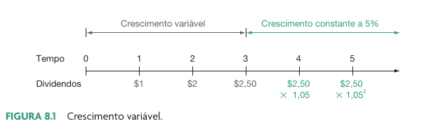
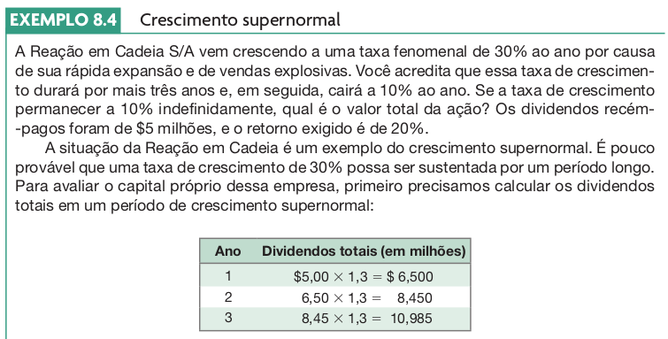
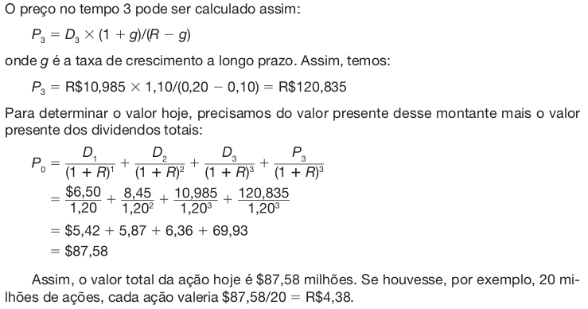

```{r}
#| echo: false
classtools::setup_quarto_slides("content")
```

# Introdução a valoração de ações

## Fluxos de caixa na compra de ações (situação mais comum)

::: incremental
> Uma ação é a menor parte do capital social da empresa, dando direito
> ao recebimento de parte do lucro da empresa em cada exercício futuro.

-   Contrato é comprado pelo preço $P_0$
-   Ao longo da vida do contrato, proventos na forma de dividendos são
    pagos ao acionista
-   Contrato pode ser vendido ao preço $P_T$
-   último dividendo $DIV_T$ é pago no tempo $T$
:::

## Ilustração fluxos de caixa de ações

```{r}
library(ggplot2)

ticker <- "ABCD3"
base_div <- 15
my_T <- 8
divs <- rep(base_div, my_T-1)
first_price <- 85
last_price <- 120

CF <- c(-first_price, 
        divs, 
        last_price + base_div)

l_p <- classtools::create_cashflow_plot(first_price,
                                 divs,
                                 last_price + base_div)
p <- l_p$p + 
  labs(title = "Fluxos de caixa na compra de 1 ação",
         subtitle = glue::glue(
           paste0("Preço hoje: {first_price} | Preço venda: {last_price} | Dividendo: {base_div}")))

p
```


## Fluxos de caixa na compra de GGBR4 (Gerdau)

```{r}
ticker <- "GGBR4"
exchange <- "SA"
first_date <-  Sys.Date() - 8*365
last_date <- Sys.Date()

l_plot <- classtools::make_cashflow_plot(ticker,exchange,first_date, last_date)
l_plot$p
```

## Por que precificar uma ação?

-   Estimar se o preço de mercado está acima (sobrepreço) ou abaixo
    (desconto) do preço justo
    -   discussão sobre a eficiência do mercado financeiro
    -   planejamento de estratégias de negociação
-   Estipular o preço de contratos customizados (e.g. bônus de diretores)

## Precificação de um contrato de ação

```{r}
r_selic <- classtools::get_selic_rate()$aa

# pv.uneven retorna o VP dos fluxos em t = 1..n com sinal negativo;
# por isso o "-" abaixo. Descartamos o 1o elemento (a compra), pois ele
# ocorre em t = 0 e não entra no somatório de t = 1..T.
P_0 <- -FinCal::pv.uneven(r_selic, CF[2:length(CF)])
```

A fórmula do valor presente (PV) nos diz que:

$$VP = \sum _{t=1} ^{T} \frac{FC}{(1+r)^t} + \frac{VF}{(1+r)^T}$$

. . .

Substituindo os símbolos para ação ($D$ = dividendos, $P_0$ = preço de
compra e $P_T$ = preço de venda), temos:

$$P_0 = \sum _{t=1} ^{T} \frac{D}{(1+r)^t} + \frac{P_T}{(1+r)^T}$$ 

. . .

Para o exemplo anterior, e assumindo que $r = `r r_selic`$:

$$P_0 = \sum _{t=1} ^{`r my_T`} \frac{`r base_div`}{(1+`r r_selic`)^t} + \frac{`r last_price`}{(1+`r r_selic`)^`r my_T`}  = `r P_0`$$

Note que o último fluxo de caixa ($t = `r my_T`$) é
`r last_price` + `r base_div`, isto é, o preço de venda **mais** o último
dividendo.


# Modelo de Gordon -- [@gordon1956capital]

## Premissas

::: incremental
-   Ações são mantidas até o infinito, com o pagamento periódico dos
    proventos (dividendos)
-   O valor nominal dos dividendos são conhecidos e:
    -   **Versão 01**: Constantes
    -   **Versão 02**: Variáveis, com uma taxa de crescimento conhecida
    -   **Versão 03**: taxa de crescimento variável
-   O valor do preço da ação no futuro é desconhecido
-   A taxa de crescimento deve ser **menor** que a taxa de desconto
    ($g < r$); se $g \geq r$, o preço tende ao infinito (ou fica
    negativo) e o modelo não faz sentido
:::

## Derivação Versão 01 (dividendos constantes)

-   a ação paga o valor $DIV$ em cada período, indefinidamente
-   não é preciso assumir uma venda futura: como $T \to \infty$, o valor
    de revenda $P_T$ se torna irrelevante

. . .

<hr>

O valor presente de uma perpetuidade constante é:

$$P_0 = \sum _{t=1} ^{\infty} \frac{DIV}{(1+r)^t}$$

Sabendo que
$\sum _{t=1} ^{\infty} \frac{DIV}{(1+r)^t} = \frac{DIV}{r}$, temos:

$$P_0 =\frac{DIV}{r}$$

## Derivação Versão 02 (dividendos crescentes)

-   a ação paga o valor $DIV_t$ em cada período, indefinidamente
-   o dividendo cresce a uma taxa constante $g$: $DIV_t = DIV_0(1+g)^t$
-   aqui $DIV_0$ é o dividendo **já pago** (tempo 0); o **próximo**
    dividendo é $DIV_1 = DIV_0(1+g)$

. . .

<hr>

O valor presente da perpetuidade crescente é:

$$P_0 = \sum _{t=1} ^{\infty} \frac{DIV_0(1+g)^t}{(1+r)^t}$$

Sabendo que
$\sum _{t=1} ^{\infty} \frac{DIV_0(1+g)^t}{(1+r)^t} = \frac{DIV_0(1+g)}{r-g}$,
temos (requer $g < r$):

$$P_0 = \frac{DIV_0(1+g)}{r-g} = \frac{DIV_1}{r-g}$$

## Exemplo

```{r}
div_ex <- 10
r_ex <- 0.12
g_ex <- 0.05
```

> Uma empresa paga hoje dividendos de `r classtools::format_cash(div_ex)`.
> Considerando um custo de capital de `r classtools::format_percent(r_ex)`
> e uma taxa de crescimento de dividendos de
> `r classtools::format_percent(g_ex)`, qual o preço da ação hoje?

$$P_0 = \frac{DIV_0(1+g)}{r-g}$$
$$P_0 = \frac{`r div_ex`*(1+`r g_ex`)}{`r r_ex`-`r g_ex`}$$
$$P_0 = `r div_ex*(1+g_ex)/(r_ex-g_ex)`$$

## Sensibilidade do preço a $r$ e $g$

```{r}
df_sens <- tidyr::expand_grid(
    r = c(0.10, 0.12, 0.14),
    g = c(0.03, 0.05, 0.07)
  ) |>
  dplyr::mutate(P_0 = div_ex * (1 + g) / (r - g))

df_sens |>
  dplyr::mutate(
    r = classtools::format_percent(r),
    P_0 = classtools::format_cash(P_0)
  ) |>
  tidyr::pivot_wider(names_from = r, values_from = P_0) |>
  dplyr::mutate(g = classtools::format_percent(g)) |>
  dplyr::rename(`Crescimento (g)` = g) |>
  knitr::kable(
    col.names = c("Crescimento (g)",
                  classtools::format_percent(c(0.10, 0.12, 0.14))),
    caption = "Preço justo (P0) para diferentes taxas de desconto (r) e crescimento (g)")
```

Pequenas mudanças em $r$ ou $g$ causam **grandes** mudanças no preço:
com $r = 10\%$, o preço vai de `r classtools::format_cash(div_ex*(1+0.03)/(0.10-0.03))`
a `r classtools::format_cash(div_ex*(1+0.07)/(0.10-0.07))` só porque $g$
passou de 3% para 7%.

## Derivação Versão 03 (dividendos variáveis)

-   flexibiliza o crescimento dos dividendos. Podemos ter uma época de
    grande crescimento, e outra de estabilidade.
-   Não é preciso prever um preço de venda: o valor ao fim do primeiro
    estágio é calculado como uma perpetuidade (Gordon) sobre os
    dividendos seguintes

```{r}
#| fig-cap: !expr classtools::cite_ross(243)


```

## Exemplo (1/2)

```{r}
#| fig-cap: !expr classtools::cite_ross(243)


```

## Exemplo (2/2)

```{r}
#| fig-cap: !expr classtools::cite_ross(243)


```

## Versão 03 na prática: dois estágios

```{r}
div0 <- 10        # dividendo corrente (DIV_0)
g1   <- 0.15      # crescimento no 1º estágio
n1   <- 5         # duração do 1º estágio
g2   <- 0.03      # crescimento na perpetuidade
r_ex <- 0.12      # taxa de desconto

div_stage1 <- div0 * (1 + g1)^(1:n1)
pv_stage1  <- sum(div_stage1 / (1 + r_ex)^(1:n1))

div_terminal <- div_stage1[n1] * (1 + g2)
pv_terminal  <- (div_terminal / (r_ex - g2)) / (1 + r_ex)^n1

P0_stage <- pv_stage1 + pv_terminal
```

$$P_0 = \underbrace{\sum_{t=1}^{`r n1`}\frac{DIV_0(1+g_1)^t}{(1+r)^t}}_{\text{1º estágio}} +
\underbrace{\frac{1}{(1+r)^{`r n1`}}\cdot\frac{DIV_{`r n1+1`}}{r-g_2}}_{\text{perpetuidade}}$$

Assim, $P_0 = `r classtools::format_cash(P0_stage)`$, dos quais
`r classtools::format_percent(pv_terminal/P0_stage)` vêm apenas da
**perpetuidade**.

## Versão 03 na prática: composição do valor

```{r}
df_decomp <- tibble::tibble(
    componente = factor(
      c("Dividendos (1º estágio)", "Perpetuidade (2º estágio)"),
      levels = c("Dividendos (1º estágio)", "Perpetuidade (2º estágio)")),
    valor = c(pv_stage1, pv_terminal)
  )

p_decomp <- ggplot(df_decomp, aes(x = componente, y = valor, fill = componente)) +
  geom_col() +
  geom_text(aes(label = classtools::format_cash(valor)), vjust = -0.5, size = 5) +
  scale_y_continuous(labels = classtools::format_cash) +
  labs(
    title = "Composição do preço justo no modelo de 2 estágios",
    subtitle = glue::glue("P0 = {classtools::format_cash(P0_stage)}"),
    x = "", y = "") +
  theme_light() +
  theme(legend.position = "none")

p_decomp
```

## Extraindo Informações do Modelo de Gordon

::: incremental
-   Preços de ações são facilmente obtidos no mercado secundário
-   Informações de dividendos pagos historicamente são públicas
    -   permite o cálculo da taxa de crescimento dos dividendos
-   Com base nisso, podemos calcular o valor de $r$, o qual representa a
    **taxa exigida de retorno** do mercado financeiro.
    -   a taxa exigida pode ser usada como custo de capital em projetos
        da empresa
:::


## Matemática

Para a versão 02 de Gordon, temos:

$$P_0 = \frac{DIV_0(1+g)}{r-g}$$

Isolando o $r$:

$$r = \frac{DIV_0(1+g)}{P_0}+g $$

$$r =  \frac{DIV_1}{P_0}+g$$

Isto é, sabendo preço da ação hoje $P_0$, o custo de capital dos
investidores pode ser extraído através da fórmula anterior

## De onde vem o $g$?

Estimar $g$ a partir do histórico de dividendos é frágil: os pagamentos
são irregulares e o passado não garante o futuro. Uma alternativa é o
**crescimento sustentável**:

$$g = ROE \times (1 - payout)$$

-   uma empresa só cresce de forma perpétua retendo parte do lucro
    ($1 - payout$) e reinvestindo a uma taxa $ROE$
-   use essa estimativa como **checagem** do $g$ histórico, e não como
    verdade absoluta

## Exemplo EGIE3.SA

```{r}
ticker <- "EGIE3"
first_date <- '2018-01-01'
last_date <- Sys.Date()

l_out <- classtools::make_cashflow_plot(
    ticker, 
    "SA",
    first_date, last_date)

# Preço atual (última cotação do período)
P0 <- l_out$df_prices |>
  dplyr::slice_max(ref_date) |>
  dplyr::pull(price_close)

last_date <- max(l_out$df_prices$ref_date)

# Série ANUAL de dividendos, a partir dos proventos brutos (df_div).
# Usar df_div evita contaminar a série com o preço de compra/venda que
# aparece no cashflow anual agregado (l_out$CF).
div_anual <- l_out$df_div |>
  dplyr::mutate(year = lubridate::year(data_de_pagamento)) |>
  dplyr::group_by(year) |>
  dplyr::summarise(div = sum(valor), .groups = "drop") |>
  dplyr::arrange(year)

# CAGR dos dividendos: usa o número de anos entre o 1o e o último ponto.
# É mais robusto que a média das variações ano a ano, que fica distorcida
# quando há anos sem pagamento ou pagamentos irregulares.
n_years  <- nrow(div_anual) - 1
last_div <- dplyr::last(div_anual$div)
g  <- (last_div / dplyr::first(div_anual$div))^(1/n_years) - 1

r_est <- last_div*(1+g)/P0 + g
```

-   Em `r classtools::format_date(last_date)` a ação `r ticker` estava
    cotada a `r classtools::format_cash(P0)`
-   No seu histórico de dividendos, entre
    `r classtools::format_date(first_date)` e
    `r classtools::format_date(last_date)`, vemos uma taxa de
    crescimento anual (CAGR) de `r classtools::format_percent(g)`

. . .

Assim, temos:

$P_0 = `r classtools::format_cash(P0)`$

$g = `r classtools::format_percent(g)`$

Aplicando a fórmula:

$r = \frac{DIV_0(1+g)}{P_0} + g$

$r = `r classtools::format_percent(r_est)`$

Isso quer dizer que os investidores usam uma taxa de custo de capital de
`r classtools::format_percent(r_est)` ao ano para precificar os fluxos de
caixa da empresa com ticker `r ticker`

> **Atenção:** estimativas de $g$ e $r$ a partir de dados históricos são
> sensíveis ao período escolhido. Dividendos irregulares podem gerar
> valores pouco realistas — interprete o resultado como uma aproximação.

# Críticas ao modelo de Gordon

## Críticas

::: incremental
-   Tempo infinito?
    -   A imensa maioria dos investidores têm interesse em vender a ação
        antes de morrer!!
    -   A empresa pode entrar em processo de falência?
        -   Exemplo: Varig
-   Dividendos crescentes?
    -   Empresa não dá prejuízo, nunca?
    -   Considere 2 empresas concorrentes: as mesmas teriam dividendos
        crescentes sempre?
-   Sensibilidade extrema: pequenas mudanças em $r$ ou $g$ mudam muito
    o preço (e $g$ é difícil de estimar!)
:::

## E o que fazer então?

::: {.incremental}
-   O modelo de Gordon é um **ponto de partida**, não a resposta final
-   Alternativas usuais:
    -   DDM multinível (Versão 03) para tratar fases de crescimento
    -   Fluxo de caixa descontado (FCFE / FCFF) quando os dividendos não
        representam o potencial da empresa
    -   Múltiplos comparáveis (P/L, EV/EBITDA) como checagem de preço
        relativo
-   Na prática, o analista combina abordagens e procura um **intervalo**
    de preço justo, e não um número único
:::

# A precificação na prática

## Como funciona a precificação na prática?

::: incremental
-   Análise Fundamentalista / Valuation
    -   Análise de balanços e informações financeiras
    -   Construção de cenários econômicos e projeções de lucro
-   Análise Técnica (Grafista)
    -   Análise da história dos ativos (preços e volumes negociados)
    -   Identificação de padrões de tendência (subida ou descida das
        ações) com base apenas em gráficos
:::

## Referências {.unlisted}
