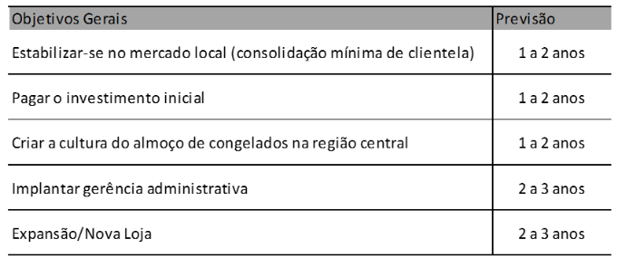
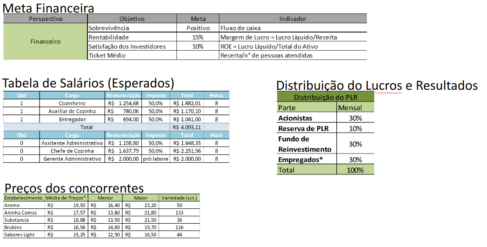
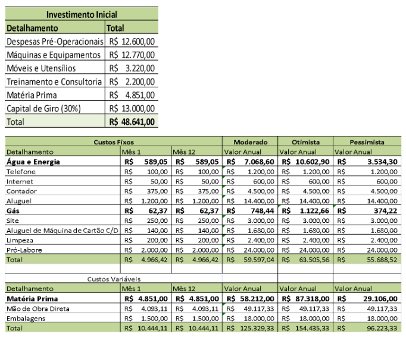
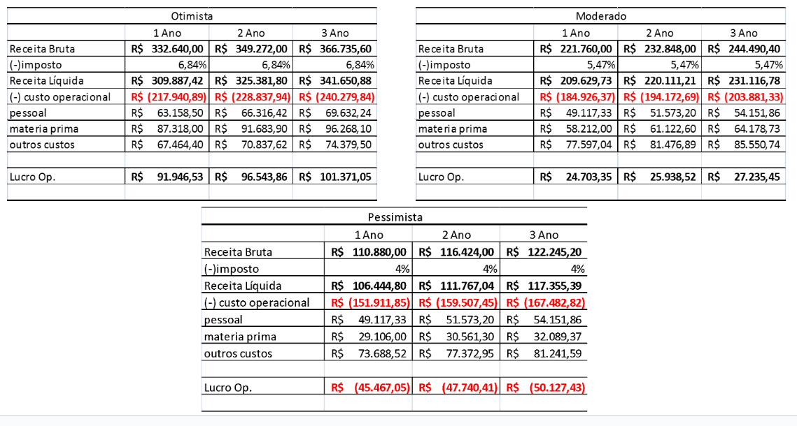
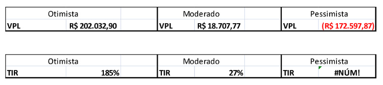

```{r}
#| echo: false
#| message: false
#| warning: false
library(knitr)
library(ggplot2)

classtools::setup_quarto_slides('content')

link_gsheets <- "https://docs.google.com/spreadsheets/d/1IhoE36u2oxeHkt5aEq88KfT7rQujJXfBqIFeQHfZphw/edit?usp=sharing"
```

# Introdução ao Orçamento de Capital

## Orçamento de Capital: A Base das Decisões Estratégicas

* **Definição:** Processo de planejamento e gestão dos investimentos de longo prazo de uma empresa.
* **Objetivo Principal:** Identificar e selecionar projetos que agreguem valor à empresa, ou seja, aqueles com **Valor Presente Líquido (VPL) positivo**.
* **Importância:** 
  - Decisões de investimento definem a capacidade produtiva e a estratégia futura.
  - Costumam envolver volumes expressivos de recursos financeiros.
  - São decisões de **difícil reversibilidade** sem perdas financeiras substanciais.

## Tipos Comuns de Projetos de Investimento

:::: {.columns}

::: {.column width="50%"}
### Quanto à Finalidade
- **Novos Produtos / Expansão:** aumento de capacidade de produção ou entrada em novos mercados.
- **Redução de Custos / Eficiência:** substituição de maquinário antigo por tecnologia mais eficiente.
- **Obrigações Regulatórias:** adequação ambiental ou de segurança.
:::

::: {.column width="50%"}
### Quanto à Dependência
- **Projetos Independentes:** a aceitação de um não impede a do outro.
- **Mutuamente Excludentes:** a escolha de uma alternativa elimina as demais (ex: escolher entre o fornecedor A ou B).
- **Projetos Contingentes:** a execução de um depende do sucesso de outro.
:::

::::

# Como Montar os Fluxos de Caixa

## Princípios para a Construção de Fluxos de Caixa

::: {.callout-tip}
## 1. Fluxos de Caixa Incrementais
Os fluxos de caixa relevantes para a avaliação consistem em **todas as alterações nos fluxos futuros da empresa que decorrem diretamente da aceitação do projeto**.
$$\text{FC do Projeto} = \text{FC da Empresa COM o projeto} - \text{FC da Empresa SEM o projeto}$$
:::

. . .

::: {.callout-note}
## 2. Princípio da Independência
O projeto deve ser avaliado como se fosse uma **"miniempresa" independente**, com suas próprias receitas, custos operacionais, depreciação e impostos.
:::

. . .

::: {.callout-warning}
## 3. Caixa vs. Competência
Interessa quando o dinheiro **entra ou sai da conta**, e não o regime contábil de competência.
:::

## O que Entra e o que NÃO Entra no Cálculo?

:::: {.columns}

::: {.column width="50%"}
::: {.callout-note}
### ✅ Entram no Cálculo

* **Custos de Oportunidade:** benefícios renunciados ao alocar um ativo no projeto (ex: imóvel próprio que poderia ser alugado).
* **Efeitos Colaterais (Erosão/Canibalismo):** impacto nas vendas de outros produtos já existentes da empresa.
* **Necessidade de Capital de Giro Líquido (CGL):** caixas, estoques e contas a receber adicionais.
* **Benefício Fiscal da Depreciação:** economia real de imposto gerada pela depreciação.
:::
:::

::: {.column width="50%"}
::: {.callout-important}
### ❌ NÃO Entram no Cálculo

* **Custos Irrecuperáveis (*Sunk Costs*):** gastos passados já incorridos que não mudam com a decisão (ex: estudo de mercado já pago).
* **Custos de Financiamento:** juros, despesas financeiras e amortizações.
  - *Motivo:* o custo do capital já está refletido na **taxa de desconto ($r$)**. Incluí-los no fluxo geraria dupla contagem!
:::
:::

:::


# Lidando com a Incerteza

## Avaliação das Estimativas de VPL

> *"Garbage in, garbage out"*: se as projeções de receitas e custos forem equivocadas, o VPL calculado perde toda a validade!

. . .

- **Risco de Previsão (ou de Modelo):** A possibilidade de tomar uma má decisão por conta de erros nas projeções de fluxo de caixa.
- **Fontes de Vantagem Competitiva:**
  - Todo VPL positivo decorre de alguma vantagem competitiva econômica (menores custos, marca, patentes, barreiras à entrada).
  - Em mercados perfeitamente competitivos, o VPL de novos investimentos tende a zero no longo prazo.

## Análise de Cenários vs. Análise de Sensibilidade

:::: {.columns}

::: {.column width="50%"}
### Análise de Cenários
- Investiga o impacto de **combinações consistentes** de variáveis:
  - **Otimista:** alta demanda, preços maiores, custos menores.
  - **Base / Mais Provável:** estimativas normais.
  - **Pessimista:** recessão, inflação de custos, baixa adesão.
- Útil para estimar a amplitude de variação do VPL.
:::

::: {.column width="50%"}
### Análise de Sensibilidade
- Altera **uma variável por vez**, mantendo todas as outras fixas (*ceteris paribus*).
- Exemplos:
  - O que acontece com o VPL se as vendas caírem 10%?
  - E se o custo variável subir 15%?
- Identifica a **variável crítica** do projeto (onde o gestor precisa ter mais controle).
:::

::::

## Análise de Ponto de Equilíbrio (*Break-Even*)

O ponto de equilíbrio indica o volume mínimo de vendas ($Q$) necessário para atingir determinado objetivo:

. . .

* **1. Ponto de Equilíbrio Contábil:** Lucro Líquido $= 0$
  $$Q_{\text{contábil}} = \frac{\text{Custos Fixos} + \text{Depreciação}}{P - V}$$

. . .

* **2. Ponto de Equilíbrio de Caixa:** FCO $= 0$ (empresa não queima caixa operacional)
  $$Q_{\text{caixa}} = \frac{\text{Custos Fixos}}{P - V}$$

. . .

* **3. Ponto de Equilíbrio Financeiro:** $\text{VPL} = 0$
  - Exige cobrir os custos fixos, recuperar o investimento inicial e remunerar o custo de oportunidade do capital! ($Q_{\text{financeiro}} > Q_{\text{contábil}} > Q_{\text{caixa}}$)

## Opções Reais: Flexibilidade Gerencial

O VPL tradicional supõe que o projeto é executado de forma estática até o fim. Na prática, gestores têm **opções reais**:

. . .

:::: {.columns}

::: {.column width="33%"}
### Opção de Expandir
Se o produto for um sucesso estrondoso, a empresa pode dobrar a capacidade ou lançar versões complementares.
:::

::: {.column width="33%"}
### Opção de Abandonar
Se as coisas derem errado, a empresa pode encerrar o projeto e vender os ativos, estancando prejuízos.
:::

::: {.column width="33%"}
### Opção de Postergar
Esperar mais alguns meses para obter novas informações antes de fazer o investimento irreversível.
:::

::::

. . .

> 💡 **Conclusão:** O VPL estático é um **limite inferior** para o valor do projeto, pois desconsidera o valor dessas opções gerenciais!

# Caso Prático: Uma Empresa de Congelados em Porto Alegre

## Estudo de Caso: TCC Defendido na UFRGS

- **Objetivo:** Analisar a atratividade econômico-financeira de abrir uma empresa de refeições congeladas na região central de Porto Alegre.
- **Horizonte de Avaliação:** Projeção para 3 anos.
- **Aplicação Real:** Utilização dos conceitos de fluxos incrementais, análise de custos e múltiplos cenários.

```{r}
#| fig-align: center

```

## Dados de Mercado e Estrutura de Custos

- Definição de metas de retorno e dimensionamento da equipe:
- Pesquisa de preços praticados por concorrentes locais:

```{r}
#| fig-align: center

```

## Investimento Inicial e Custos Operacionais

::: {.callout-note}
Note a inclusão do **Capital de Giro (R$ 13.000,00)** compondo o investimento inicial total de R$ 48.641,00:
:::

```{r}
#| fig-align: center

```

## DRE Projetada sob Três Cenários

Projeção de DRE para os 3 primeiros anos sob cenários **Otimista**, **Moderado** e **Pessimista**:

```{r}
#| fig-align: center

```

## Avaliação Final: VPL e TIR

```{r}
#| fig-align: center

```

. . .

::: {.callout-warning}
### Reflexões Didáticas sobre o Resultado
- No **Cenário Pessimista**, a TIR acusa `#NUM!` porque todos os fluxos operacionais são negativos (não há mudança de sinal nos fluxos, impossibilitando encontrar raiz interna).
- A grande dispersão do VPL (de **-R$ 172 mil** a **+R$ 202 mil**) evidencia o alto risco de previsão inerente a novos empreendimentos.
:::

## Resumo e Boas Práticas em Orçamento de Capital

::: {.incremental}
1. **Pense em termos de caixa incremental:** Foque apenas no que muda com o projeto.
2. **Esqueça os custos irrecuperáveis (*Sunk Costs*):** Decisões olham para o futuro.
3. **Não deduza despesas financeiras nos fluxos:** O custo da dívida já está em $r$.
4. **Lembre-se sempre do Capital de Giro:** Injeção inicial e recuperação ao final.
5. **Use análise de sensibilidade e cenários:** O VPL pontual é apenas uma estimativa; entenda onde moram os riscos.
:::

## Referências

